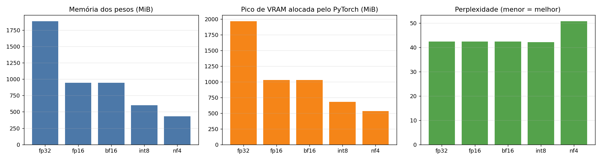
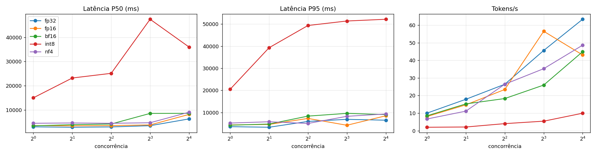

# 🚀 RealTime-ML-Inference-Lab — laboratório de serving de inferência ML em GPU, do request HTTP ao forward pass batched

### PyTorch · Hugging Face Transformers · bitsandbytes · FastAPI/WebSocket (async) · Prometheus · Grafana · Docker Compose · pytest/pytest-asyncio

   

## 🟡 Status

**Serving real e testado (M0–M3, M2/M3/M6/M7 aprofundados) + V0.3: backends de geração de texto plugáveis com quantização medida** — o serviço agora serve também um SLM real (Qwen2.5-0.5B-Instruct) em FP32/FP16/BF16/INT8/NF4 com o mesmo batching, admissão e cancelamento. **vLLM real: BLOCKED_BY_CONFIGURATION** — o `VLLMBackend` está completo e testado contra um mock do protocolo, mas a imagem Docker do vLLM não terminou de baixar dentro do limite da tentativa, então **não existe nenhum benchmark de vLLM real neste repositório**. Triton real não foi tentado.

| Área | Estado | Evidência |
|---|---|---|
| Serving assíncrono (FastAPI/WS) | ✅ Implementado e testado | `tests/test_app_integration.py` |
| Batching dinâmico | ✅ Implementado e testado | `tests/test_batching.py` (prova: N requests → menos de N forward passes) |
| Cache LRU | ✅ Implementado e testado | `tests/test_cache.py` |
| Admission control explícito | ✅ Implementado e testado | `tests/test_admission.py` (7 testes, função pura) |
| Cancelamento real (fila + WS disconnect) | ✅ Implementado e testado | `tests/test_cancellation.py` (6 testes) |
| Telemetria de GPU real | ✅ Implementado e lido a cada scrape | `inference_service/gpu_telemetry.py` |
| Observability (Prometheus/Grafana) | ✅ Executada via Docker e verificada via API | `observability/evidence/*.json` |
| Capacity planning (concurrency sweep) | ✅ Medido, não estimado | `loadtest/reports/capacity-sweep-20261008-141215.{json,md}` |
| Adapters Triton (KServe v2) / vLLM (OpenAI-compatible) | 🟡 Protocolo real, só testado contra mock local | `adapters/triton_vllm/`, `tests/test_adapters.py` |
| Backends plugáveis (`tinycnn` / `hf` / `vllm`) | ✅ Implementado e testado | `inference_service/backends/`, `tests/test_backends_factory.py` |
| Serviço de geração (`/generate`) com batching, admissão e cancelamento | ✅ Implementado e testado (modelo real nos testes) | `inference_service/llm_app.py`, `llm_batching.py`, `tests/test_llm_*.py`, `tests/test_hf_backend.py` |
| HuggingFaceBackend: FP32 / FP16 / BF16 / INT8 / NF4 | ✅ Medido (5 modos, rodada limpa) | `benchmarks/results/quant-20261021-193218.{json,md,png}` |
| VLLMBackend | 🟡 Cliente real, testado só contra mock do protocolo | `tests/test_vllm_backend.py` |
| vLLM real | ⛔ BLOCKED_BY_CONFIGURATION — `docker pull` concluiu 8 de 40 camadas no limite de 15 min | `docker-compose.vllm.yml`, `scripts/run_vllm_wsl.sh`, `WORKLOG.md` |
| Triton real, multi-GPU, TensorRT, CUDA Graphs, voz/WebRTC | ⏳ Não implementado (fora de escopo) | `ROADMAP.md` (M4/M5, V2, V3) |

---

## Descrição / Contexto

Este repositório é um laboratório de **serving de inferência de machine learning em GPU em tempo real**: um serviço FastAPI assíncrono que recebe requisições HTTP e WebSocket, agrupa-as dinamicamente em lotes (batching), aplica cache, controle de admissão, cancelamento real de requisições em voo, expõe telemetria de GPU e métricas de produção via Prometheus/Grafana, e inclui clientes HTTP reais para servidores de inferência especializados (NVIDIA Triton, vLLM).

A partir da **v0.3.0** o serviço tem um segundo caminho, `inference_service/llm_app.py`, que serve **geração de texto** por um backend plugável (`RTML_BACKEND=hf|vllm`): o mesmo controle de admissão (HTTP 429), batching dinâmico adaptado a geração (padding à esquerda, orçamento de tokens por sequência) e cancelamento real (na fila, durante a geração e na desconexão do cliente). O caminho histórico do TinyCNN continua intacto.

No caminho histórico, o modelo servido é uma CNN pequena (`TinyCNN`) com pesos **não treinados** — o objetivo do repositório não é a acurácia de um modelo, mas a infraestrutura de serving em si: como requisições concorrentes são agrupadas, cacheadas, admitidas ou rejeitadas sob carga, e canceladas sem desperdiçar GPU.

## 🧭 Origem do Projeto

Este repositório nasceu de uma **auditoria de portfólio** conduzida sobre o conjunto de projetos do autor, que identificou um gap explícito na seção **"7) ML SYSTEMS / GPU / REAL-TIME INFERENCE"**: nenhum repositório do portfólio demonstrava, com código real e testado, infraestrutura de serving de ML de baixa latência — batching dinâmico, cache, backpressure, métricas de produção, cliente real para servidores de inferência especializados.

O projeto foi conduzido em três sessões, cada uma com um gate de evidência real antes de avançar:

1. **Sessão 1 (2026-10-07) — MVP.** Verificação de ambiente antes de qualquer suposição: a hipótese de partida era "provavelmente sem GPU", mas `torch.cuda.is_available()` retornou `True` com uma NVIDIA RTX 3060 Ti real disponível — documentado honestamente em vez de manter a suposição original. Implementado o núcleo de serving (modelo, cache, batching, métricas, app) e os adapters HTTP para Triton/vLLM, com 23 testes passando.
2. **Sessão 2 (2026-10-08) — aprofundamento.** Uma especificação mais madura, fornecida fora do repositório (`03_RealTime-ML-Inference-Lab.md` + `RealTime_ML_Inference_Lab_Master_Spec.txt`), definiu milestones M0–M7 mais precisos. Em vez de espalhar esforço fino sobre todos os milestones, a decisão foi aprofundar M2 (admission control), cancelamento real (hipótese H5 do master spec), M6 (telemetria de GPU + observability executada de verdade) e M7 (capacity planning via concurrency sweep medido) — deixando M4/M5 (Triton/vLLM reais) e V2/V3 (TensorRT, multi-GPU, voz) explicitamente fora de escopo e documentados como tal.
3. **Sessão 3 (2026-10-21) — V0.3, geração de texto e quantização.** O repositório servia só uma CNN de brinquedo; a lacuna declarada nos próprios README/ROADMAP era "vLLM real, quantization e um modelo de linguagem de verdade". Esta sessão adicionou a interface de backends, o serviço de geração, a quantização real (bitsandbytes) medida com o mesmo load test e o `VLLMBackend`. A primeira rodada completa do benchmark saiu **contaminada** por outros processos usando a mesma GPU (compartilhada com o resto da máquina) e foi descartada como comparação — preservada em `benchmarks/results/contaminated-20261021-150837/` com uma nota explicando o porquê; o runner passou a esperar a GPU ficar ociosa e a sinalizar cada modo como medição limpa ou não.
4. Cada afirmação do README é rastreável a um teste automatizado, um log de execução real ou um arquivo de evidência salvo em `observability/evidence/` — nenhum número foi estimado quando uma medição real era possível.

## 🎯 Objetivo

- Demonstrar serving assíncrono (FastAPI + WebSocket) que não bloqueia o event loop por requisição individual.
- Separar admission control (capacity? → admit : reject) do batching, como uma decisão pura e testável isoladamente.
- Implementar batching dinâmico real: agrupar requisições concorrentes em um único forward pass, com prova automatizada de que N requisições geram menos de N forward passes.
- Implementar cancelamento real de requisições em andamento, provando que um item cancelado nunca chega à GPU/CPU.
- Expor telemetria de GPU real (VRAM alocada/reservada, utilização) lida a cada scrape, nunca estimada.
- Validar observabilidade de produção (Prometheus + Grafana) **rodando de verdade**, não apenas configurada em arquivo.
- Medir o ponto de saturação de capacidade via concurrency sweep real, não inferir por fórmula.
- Implementar clientes HTTP reais para servidores de inferência especializados (Triton KServe v2, vLLM OpenAI-compatible).
- Servir um modelo de linguagem real por um backend plugável e **medir** o custo/benefício de FP32, FP16, BF16, INT8 e NF4 (memória, latência, vazão, qualidade) com o mesmo load test.

## 🔬 Linha de Pesquisa / Desenvolvimento

Model serving, streaming inference, batching/scheduling, caching, backpressure, admission control, cancelamento cooperativo, observabilidade de sistemas assíncronos, capacity planning — a mesma linha de skills listada na seção 7 da auditoria de portfólio que originou o repositório.

## 🏗️ Arquitetura

### Sistema

```
Cliente HTTP/WS
      │
      ▼
FastAPI app (inference_service/app.py)
      │  hash do input → cache hit? ─── sim ──► retorna direto (sem forward pass)
      ▼ não
AdmissionController (inference_service/admission.py)
      │  capacity? -> admit : reject (decisão pura, testável isolada)
      ▼ admit                              ▼ reject
DynamicBatcher (inference_service/batching.py)      HTTP 429 imediato (backpressure real)
      │  asyncio.Queue + cancelamento real
      │  (request cancelado nunca é empilhado no tensor)
      │  agrupa N requests em até max_wait_ms / max_batch_size
      ▼
ModelBackend (inference_service/model.py) — TinyCNN real em CUDA/CPU
      │
      ▼
Prometheus metrics (inference_service/metrics.py + gpu_telemetry.py)
      │
      ▼ /metrics
Prometheus (scrape real) ──► Grafana (dashboard provisionado)

adapters/triton_vllm/ — clientes HTTP reais para Triton (KServe v2) e vLLM (OpenAI-compatible)
                         (sem backend real disponível nesta sessão — ver Limitações)
```

### Microarquitetura — módulos

| Módulo | Função | Teste |
|---|---|---|
| `inference_service/config.py` | Settings centralizadas, 100% via env vars (`RTML_*`) | usado implicitamente por toda a suite |
| `inference_service/model.py` | `TinyCNN` (PyTorch real), device CUDA/CPU automático | `tests/test_batching.py`, `tests/test_cancellation.py` |
| `inference_service/cache.py` | Cache LRU por hash SHA-256 do input | `tests/test_cache.py` |
| `inference_service/admission.py` | `AdmissionController.decide(in_flight)` — função pura | `tests/test_admission.py` (7 testes) |
| `inference_service/batching.py` | `DynamicBatcher` — fila asyncio, janela de batch, cancelamento real | `tests/test_batching.py`, `tests/test_cancellation.py` |
| `inference_service/gpu_telemetry.py` | Leitura real de VRAM/utilização da GPU a cada scrape | integração via `tests/test_app_integration.py` |
| `inference_service/metrics.py` | Métricas Prometheus (latência, throughput, cache, batch, cancelamentos) | `tests/test_app_integration.py` |
| `inference_service/app.py` | FastAPI app: `POST /infer`, `WS /ws/infer`, `POST /cancel/{id}`, `/health`, `/metrics` | `tests/test_app_integration.py` |
| `adapters/triton_vllm/triton_client.py` | Cliente HTTP real, protocolo Triton KServe v2 | `tests/test_adapters.py` (contra mock local) |
| `adapters/triton_vllm/vllm_client.py` | Cliente HTTP real, API OpenAI-compatible (vLLM) | `tests/test_adapters.py` (contra mock local) |
| `loadtest/load_test.py` | Gerador de tráfego HTTP real + concurrency sweep + relatório; `--scenario llm` (V0.3) mede tokens/s e TTFT | execução real, ver Resultados |
| `inference_service/backends/base.py` | Protocolo `InferenceBackend`/`TextBackend`, `GenerationRequest/Result` | `tests/test_backends_factory.py` |
| `inference_service/backends/hf.py` | `HuggingFaceBackend`: Qwen2.5-0.5B em fp32/fp16/bf16/int8/nf4; lote com padding à esquerda, orçamento e cancelamento por sequência, TTFT, sonda de qualidade | `tests/test_hf_backend.py` (modelo real) |
| `inference_service/backends/vllm_backend.py` | `VLLMBackend`: cliente do servidor vLLM (batching contínuo no servidor) | `tests/test_vllm_backend.py` (mock do protocolo) |
| `inference_service/backends/factory.py` | `create_backend(name)` por `RTML_BACKEND` | `tests/test_backends_factory.py` |
| `inference_service/llm_batching.py` | `LLMBatcher`: fila, janela, admissão, cancelamento, geração em thread; modo remoto sem agrupar | `tests/test_llm_batching.py` (13 testes) |
| `inference_service/llm_app.py` | FastAPI de geração: `POST /generate`, `/cancel/{id}`, `/quality`, `/health`, `/metrics` | `tests/test_llm_app.py` |
| `inference_service/llm_metrics.py` | Métricas `rtml_llm_*` (latência, TTFT, tokens/s, lote, memória do modelo, pico de VRAM) | `tests/test_llm_app.py` |
| `benchmarks/run_quant_benchmark.py` | Orquestra o benchmark de quantização: sobe o serviço real por modo, roda o load test, amostra a GPU, mede qualidade | execução real, ver Resultados |

## ⚙️ Funcionamento

1. Uma requisição chega via `POST /infer` ou `WS /ws/infer` com um vetor de floats (`RTML_INPUT_DIM`, default 3×32×32 = 3072, formato CIFAR-like), recebendo um `request_id` (gerado ou fornecido pelo cliente).
2. O hash do input é verificado no cache (`inference_service/cache.py`, LRU real). Hit → retorna sem tocar o modelo.
3. Miss → `AdmissionController.decide(...)` decide, com base no `in_flight` atual vs `RTML_MAX_QUEUE_DEPTH`, se a requisição é admitida. Rejeitada → HTTP 429 imediato (backpressure real, não timeout). Admitida → entra na fila do `DynamicBatcher`.
4. Um worker assíncrono único drena a fila: pega a primeira requisição disponível, continua absorvendo mais (até `RTML_MAX_BATCH_SIZE`) enquanto não passar `RTML_MAX_BATCH_WAIT_MS` desde a primeira. Isso é o batching dinâmico.
5. Antes do forward pass, qualquer requisição marcada como cancelada (via `POST /cancel/{request_id}` ou desconexão do WebSocket) é **filtrada do batch** — nunca é empilhada no tensor, nunca toca GPU/CPU.
6. O batch (já sem os cancelados) é empilhado em um tensor e passa por **um único** forward pass do modelo (GPU ou CPU). Cada requisição recebe sua fatia do resultado.
7. Resultado é salvo no cache e devolvido ao cliente. Métricas (latência, batch size, cache hit/miss, forward passes, profundidade de fila, cancelamentos, telemetria GPU) são atualizadas em `/metrics`.

### Fluxo ponta a ponta (texto)

```
cliente --POST /infer--> app.py --cache miss--> AdmissionController.decide()
   --admit--> DynamicBatcher.submit() --fila asyncio--> worker drena até
   max_batch_size OU max_wait_ms --> filtra cancelados --> model_backend.infer_batch()
   (1 forward pass para N requests) --> resultado --> cache.set() --> resposta ao cliente
   --> métricas Prometheus atualizadas --> scrape por Prometheus --> painel Grafana
```

## 🧠 Verificação / Modelagem

| Camada | O que prova | Resultado |
|---|---|---|
| `tests/test_admission.py` | `AdmissionController.decide()` é uma função pura sobre `(in_flight, max_queue_depth)`, sem asyncio/fila/modelo | 7 testes, 100% passando |
| `tests/test_batching.py` | Requisições concorrentes são realmente agrupadas em menos forward passes que requisições | confirmado também no load test (2000 requests → 976 forward passes) |
| `tests/test_cancellation.py` | Um request cancelado na fila nunca chega ao `model_backend.infer_batch()` (`forward_pass_count == 0`) | 6 testes, 100% passando |
| `tests/test_app_integration.py` | Fluxo HTTP/WS completo, incluindo cancelamento real via desconexão de WebSocket (conexão fechada de verdade, contador Prometheus lido depois) | integração real, não mockada |
| `tests/test_cache.py` | Cache LRU por hash determinístico do input, tolerante a ruído de ponto flutuante (6 casas decimais) | testes unitários |
| `tests/test_adapters.py` | Clientes Triton/vLLM falam o protocolo de wire real contra um mock HTTP local (`httpx.ASGITransport`) | mock da dependência externa ausente, não do comportamento do cliente |

O modelo servido (`TinyCNN`, `inference_service/model.py`) é uma CNN pequena e real em PyTorch (2 blocos conv+relu+maxpool, 3→16→32 canais, + linear final, entrada 3×32×32, saída softmax sobre `RTML_NUM_CLASSES`, default 10), com pesos inicializados por seed fixa (`RTML_MODEL_SEED`) e **não treinados** — propositalmente, porque o foco é a infraestrutura de serving, não a tarefa de classificação.

## 🧪 Desenvolvimento Experimental

Fluxo seguido nas duas sessões: ler a spec/auditoria → implementar módulo por módulo → testar com `pytest` real contra o event loop asyncio real e a GPU/CPU real → rodar o serviço de verdade (`uvicorn`) → gerar carga real (`load_test.py`) → documentar achados honestamente, sem forjar números melhores.

**Achados reais (não plantados):**

1. **Event loop mismatch entre testes.** Primeira rodada de testes: 7 falhas em `tests/test_app_integration.py` por `asyncio.Queue`/`asyncio.Lock` instanciados como singletons de módulo, reutilizados entre sessões de `TestClient` — cada sessão de teste roda seu próprio event loop, e os objetos asyncio ficam ligados ao loop em que foram criados. Causa real, não hipotética: cada `TestClient` cria um novo loop, os singletons antigos apontavam para o loop anterior. Correção: criação lazy da queue/lock dentro de `start()`/`_ensure_initialized()`, reset em `stop()`.
2. **Cache compartilhado entre testes.** Segunda rodada: 3 falhas por um teste "contaminar" o cache de outro ao reaproveitar o mesmo vetor de input. Correção: fixture `autouse` que limpa `result_cache` e reseta contadores do modelo antes/depois de cada teste.
3. **`torch.cuda.utilization()` falha sem `nvidia-ml-py`.** Ao implementar telemetria de GPU, `torch.cuda.utilization()` levantou `RuntimeError: nvidia-ml-py does not seem to be installed` — confirmado rodando no ambiente real antes de qualquer correção (não assumido). Corrigido instalando `nvidia-ml-py` no Python canônico; reconfirmado retornando valores reais (7%, depois 25% sob carga simulada). Decisão de design que resultou disso: se a leitura falhar por qualquer motivo em outro ambiente, a métrica correspondente simplesmente **não é publicada** naquele scrape — nunca um valor inventado.
4. **Bug real de bind-mount do Google Drive com Docker.** `docker compose up -d` executado diretamente dentro da pasta do repositório (sincronizada pelo Google Drive Desktop, unidade `G:`) falhou com `mount ... not a directory` ao tentar bind-mountar o arquivo `prometheus.yml` — o filesystem virtual do Google Drive não se comporta como um filesystem local para bind mounts de arquivo único do Docker (mesma classe de problema já documentada no control plane do autor para `node_modules`/junctions em projetos Node). Contorno aplicado: os arquivos de configuração (`docker-compose.yml`, `prometheus/prometheus.yml`, provisioning do Grafana) foram copiados para uma pasta de staging local fora do Drive (`C:\tmp\rtml-observability`), e `docker compose up -d` foi executado de lá, apontando para o `/metrics` real do serviço rodando no host via `host.docker.internal:8000`. Os arquivos-fonte do repositório não foram alterados — apenas o diretório de execução do compose precisa estar fora da pasta sincronizada.
5. **Latência alta em single-level load test.** No load test de nível único (sessão 1), P50 de 610ms para uma CNN minúscula em GPU era alto para o tamanho do modelo. Hipótese documentada (não comprovada por profiling ainda): overhead de seleção de algoritmo cuDNN a cada novo shape de batch, somado a overhead de sincronização CUDA por chamada — já que o batching dinâmico gera batches de tamanho variável. Ver "Próximos Passos" para o profiling real planejado (Nsight Systems / PyTorch Profiler).
6. **Joelho de fila (queueing knee) medido diretamente.** No concurrency sweep, o throughput caiu de 119 para 53 req/s exatamente na transição de concorrência 8 → 16, com P95 saltando de 89ms para 784ms (quase 9x) — o comportamento clássico de fila saturada observado como medição direta, não inferido por fórmula de capacidade teórica.

## 🛠️ Tecnologias

- **Linguagens:** Python 3.10.
- **Frameworks/Runtime:** PyTorch 2.13 (cu126) · Hugging Face Transformers 5.16 · bitsandbytes 0.50 (INT8/NF4) · FastAPI · Starlette/Uvicorn · WebSockets · Pydantic v2.
- **Observabilidade:** prometheus-client · nvidia-ml-py (telemetria GPU real) · Prometheus · Grafana · Docker Compose.
- **Integração externa:** httpx (clientes Triton/vLLM e mock local via `ASGITransport`).
- **Testes:** pytest · pytest-asyncio (94 testes).
- **Infra de inferência (protocolo real, sem backend testado end-to-end):** NVIDIA Triton Inference Server (KServe v2 HTTP) · vLLM (API OpenAI-compatible).

## 📊 Resultados

### Load test single-level (sessão 2026-10-07, mantido para referência)

`python loadtest/load_test.py --requests 2000 --concurrency 32` — pior caso: cada request com input aleatório diferente, sem reaproveitar cache.

| Métrica | Valor medido |
|---|---|
| Requisições totais | 2000 |
| Erros | 0 |
| Duração | 43.87 s |
| Throughput | 45.59 req/s |
| Latência P50 | 610.03 ms |
| Latência P95 | 1186.59 ms |
| Latência P99 | 1954.23 ms |
| Latência min/max | 113.19 ms / 3363.35 ms |
| Forward passes executados | 976 (para 2000 requests → batch médio ≈ 2.05) |

Batching funcionando de verdade: 2000 requisições lógicas resultaram em apenas 976 forward passes reais — confirmado tanto no load test quanto no teste automatizado `tests/test_batching.py::test_concurrent_requests_are_batched_into_fewer_forward_passes`.

**Nota de honestidade sobre a latência:** 610ms de P50 para uma CNN minúscula em GPU é alto para o tamanho do modelo. A causa mais provável é overhead de seleção de algoritmo cuDNN a cada novo shape de batch (batches de tamanho variável disparam reotimização interna do cuDNN) somado a overhead de sincronização CUDA por chamada — não throughput real de computação do modelo. É um achado real do ambiente de teste (processo único, Windows, batches de tamanho variável), não um número ajustado.

### Concurrency sweep / capacity planning (sessão 2026-10-08)

`python loadtest/load_test.py --sweep 1,2,4,8,16,32,64 --requests-per-level 300` rodado contra a instância local real (GPU NVIDIA RTX 3060 Ti). Relatório completo em `loadtest/reports/capacity-sweep-20261008-141215.{json,md}`.

| Concorrência | Requests | Duração (s) | Throughput (req/s) | Erro | P50 (ms) | P95 (ms) | P99 (ms) |
|---|---|---|---|---|---|---|---|
| 1 | 300 | 3.92 | 76.51 | 0.0% | 12.6 | 15.0 | 16.8 |
| 2 | 300 | 3.43 | 87.34 | 0.0% | 21.7 | 24.4 | 29.7 |
| 4 | 300 | 2.58 | 116.36 | 0.0% | 33.6 | 42.3 | 45.1 |
| 8 | 300 | 2.52 | **119.11 (pico)** | 0.0% | 64.4 | 89.5 | 159.3 |
| 16 | 300 | 5.61 | 53.45 | 0.0% | 205.7 | 783.7 | 1149.4 |
| 32 | 300 | 4.73 | 63.43 | 0.0% | 372.8 | 1223.1 | 1707.1 |
| 64 | 300 | 4.64 | 64.60 | 0.0% | 975.9 | 1425.3 | 1467.4 |

**Ponto de saturação medido (não estimado): concorrência = 8.** Entre concorrência 8 → 16, o throughput cai de 119 para 53 req/s (−55%) enquanto o P95 salta de 89ms para 784ms (≈8,8x) — o joelho de fila clássico (queueing delay dominando a latência) observado diretamente neste hardware/modelo/configuração de batching, não inferido por fórmula. Zero erros em todos os níveis — o `RTML_MAX_QUEUE_DEPTH` default (64) absorveu toda a carga testada sem rejeitar nada via HTTP 429; a degradação é de latência de fila, não de admissão rejeitando. Regra de detecção de saturação usada pelo script (`_find_saturation_point` em `loadtest/load_test.py`): taxa de erro > 1% OU P95 mais que dobra vs. o nível anterior enquanto o throughput para de crescer (variação < 15%).

### Backends de geração e quantização (sessão 2026-10-21, v0.3.0)

Modelo: `Qwen/Qwen2.5-0.5B-Instruct` (494 M parâmetros) · GPU: NVIDIA RTX 3060 Ti (8 GB, **compartilhada** com o resto da máquina) · torch 2.13.0+cu126 · transformers 5.16.1 · bitsandbytes 0.50.2 · commit-base `5ac83c4` (com as mudanças da v0.3 ainda não commitadas).
Carga: `benchmarks/run_quant_benchmark.py` sobe o serviço real (`uvicorn inference_service.llm_app:app`) por modo e roda `loadtest/load_test.py --scenario llm` — 24 requisições por nível de concorrência (1, 2, 4, 8, 16), 32 tokens novos, lote máximo 8, janela de 20 ms, decodificação greedy, sem cache de resultado. Relatório completo (todos os níveis, TTFT, uso de GPU amostrado por `nvidia-smi`): `benchmarks/results/quant-20261021-193218.{json,md}` e gráficos `quant-20261021-193218-*.png`.

| Modo | Pesos (MiB) | Pico PyTorch (MiB) | Perplexidade | Greedy = FP32 | tok/s @c=1 | P50 @c=1 (ms) | tok/s @c=8 | P50 @c=8 (ms) | P95 @c=8 (ms) | Medição limpa |
|---|---|---|---|---|---|---|---|---|---|---|
| fp32 | 1885 | 1964 | 42.43 | 8/8 | 10.0 | 3092 | 45.6 | 3559 | 6922 | sim |
| fp16 | 942 | 1029 | 42.38 | 7/8 | 8.1 | 3613 | 56.5 | 3876 | 4248 | sim |
| bf16 | 942 | 1029 | 42.43 | 7/8 | 8.5 | 3507 | 26.0 | 8625 | 9623 | sim |
| int8 | 601 | 681 | 42.09 | 3/8 | 2.0 | 15050 | 5.4 | 47445 | 51372 | sim |
| nf4 | 430 | 531 | 50.73 | 2/8 | 6.7 | 4559 | 35.3 | 4773 | 8287 | sim |

(`Pesos` = `get_memory_footprint()`; `Pico PyTorch` = `torch.cuda.max_memory_allocated()`; `Greedy = FP32` = saídas greedy idênticas à do FP32 em 8 prompts fixos.)

**O que esta medição sustenta (e o que não):**

- **Memória — robusto.** Pesos: FP32 1885 MiB → FP16/BF16 942 MiB (−50%) → INT8 601 MiB (−68%) → NF4 430 MiB (−77%). O pico de VRAM alocada acompanha.
- **Qualidade — sinal fraco, mas coerente.** Perplexidade (6 textos fixos): praticamente igual até INT8 (42,09–42,43); o NF4 sobe para 50,73 (+19,6% sobre o FP32). A concordância greedy cai de 8/8 (FP32) para 7/8 (FP16/BF16), 3/8 (INT8) e 2/8 (NF4). São 8 prompts curtos: indica *direção*, não é um benchmark de tarefa.
- **INT8 é muito mais lento — robusto.** ≈ 5,4 tok/s a concorrência 8 contra 56,5 do FP16 (≈ 10×), e o mesmo padrão apareceu na rodada contaminada descartada (7,8 tok/s). O LLM.int8() do bitsandbytes economiza memória, não tempo, num modelo pequeno como este. O NF4 fica na faixa do FP16 (35,3 contra 56,5 tok/s a concorrência 8; 6,7 contra 8,1 tok/s a concorrência 1).
- **FP32 × FP16 × BF16 — não ranquear.** As diferenças entre os três estão dentro do ruído desta medição: uma única rodada de 24 requisições por nível, e a formação do lote varia de uma execução para outra (por exemplo, o BF16 a concorrência 8 teve TTFT P50 de 4,3 s porque o lote não se formou de uma vez, enquanto o FP16 formou). A utilização média da GPU ficou em ~17–21% em todos os modos: com um modelo de 0,5 B, o gargalo é o overhead de Python/lançamento de kernels por token, não a computação — por isso o FP32 não perde para o FP16 aqui. Isso **não** se extrapola para modelos maiores.
- **Contaminação.** A GPU é compartilhada. A primeira rodada completa coincidiu com outros processos usando a GPU (baseline ocioso de 94% de uso e 6 GB em uso antes do FP16) e foi descartada; ela fica em `benchmarks/results/contaminated-20261021-150837/` com a `NOTA.md`. A rodada acima esperou a GPU ficar ociosa antes de cada modo (6–18% de uso e 750–870 MiB de baseline) e todos os modos saíram marcados como "medição limpa". Mesmo assim, não é um ambiente isolado.
- **TTFT** é a espera em fila + prefill do lote medida no backend, não streaming token a token; o vLLM não reporta TTFT nesta versão.




**Como reproduzir** (Python 3.10 com torch/transformers/bitsandbytes; o modelo precisa estar no cache do Hugging Face):

```bash
python benchmarks/run_quant_benchmark.py --modes fp32,fp16,bf16,int8,nf4 \
    --sweep 1,2,4,8,16 --requests-per-level 24 --max-new-tokens 32
# ou subir um modo à mão:
RTML_BACKEND=hf RTML_HF_QUANT=nf4 python -m uvicorn inference_service.llm_app:app --port 8100
python loadtest/load_test.py --scenario llm --base-url http://127.0.0.1:8100 --sweep 1,2,4,8
```

**vLLM real — BLOCKED_BY_CONFIGURATION.** O vLLM não roda nativo no Windows. O `docker run --gpus all` funciona nesta máquina (validado com `nvidia-smi` dentro de um contêiner), mas o `docker pull vllm/vllm-openai:latest` concluiu apenas 8 das 40 camadas no limite de 15 minutos da tentativa, então a imagem não ficou disponível e nenhuma medição de vLLM foi feita. Ficam prontos para quando a imagem existir: `docker-compose.vllm.yml`, `scripts/run_vllm_wsl.sh` e o `VLLMBackend` (testado contra um servidor mock do protocolo OpenAI-compatible). O painel `observability/grafana/dashboards/llm-dashboard.json` e o job de scrape na porta 8100 cobrem os dois backends.

### Suite de testes

94 testes (`pytest`), **100% passando, nenhum pulado** — `pytest -q` → `94 passed in 164.54s` (v0.3.0, numa cópia local em `D:` por causa da lentidão de import a partir do Google Drive). Composição: os 40 testes da v0.2.0 (inalterados) + 54 novos: seleção de backend e validação de quantização, `LLMBatcher` com dublê (agrupamento, limite de lote, admissão, cancelamento antes e durante a geração, timeout, TTFT, modo remoto), `llm_app` (contrato HTTP, 422/429/499, métricas), `VLLMBackend` contra mock do protocolo e 9 testes do `HuggingFaceBackend` com o **modelo real** (lote com padding à esquerda igual à geração individual, orçamento por sequência, cancelamento por sequência, sonda de qualidade, INT8 e NF4 reduzem a memória, batching HTTP no modelo real). Os testes com modelo real exigem GPU e o modelo no cache local; sem eles, são pulados com motivo explícito.

## 🖼️ Evidências

Evidência real capturada via API HTTP do Prometheus/Grafana rodando de verdade via Docker Compose, salva em `observability/evidence/` (JSON cru, não screenshots):

| Arquivo | O que prova |
|---|---|
| `observability/evidence/prometheus_targets.json` | `GET /api/v1/targets` → `health: "up"` para o job `realtime-ml-inference-lab`, scrape real de `http://host.docker.internal:8000/metrics` |
| `observability/evidence/prometheus_query_gpu_available.json` | `GET /api/v1/query?query=rtml_gpu_available` → `1` (GPU real detectada pelo processo raspado) |
| `observability/evidence/prometheus_query_requests_total.json` | `GET /api/v1/query?query=rtml_requests_total` → contador real refletindo requisições HTTP enviadas durante o teste |
| `observability/evidence/prometheus_query_gpu_memory.json` | `GET /api/v1/query?query=rtml_gpu_memory_allocated_bytes` → bytes reais alocados na GPU |
| `observability/evidence/grafana_datasource.json` | Datasource "Prometheus" provisionado automaticamente, apontando para `http://prometheus:9090` |
| `observability/evidence/grafana_dashboards.json` | `GET /api/search?type=dash-db` → dashboard `RealTime-ML-Inference-Lab` (uid `rtml-inference-lab`) carregado de verdade no Grafana |

Relatório de capacity sweep machine-generated: `loadtest/reports/capacity-sweep-20261008-141215.json` (dados brutos) e `.md` (tabela formatada, reproduzida na seção Resultados acima).

## 🚀 Aplicações

- Referência de arquitetura para serviços de inferência de ML que precisam de baixa latência sob carga concorrente (visão computacional, NLP, recomendação) sem depender de um servidor de inferência especializado dedicado.
- Base para comparação entre serving "caseiro" (este repositório) e servidores especializados (Triton, vLLM) usando os mesmos adapters HTTP, uma vez que um backend real esteja disponível para teste.
- Material de estudo/portfólio para padrões de admission control, batching dinâmico, cancelamento cooperativo e backpressure em sistemas assíncronos Python (asyncio).
- Esqueleto de observability (Prometheus + Grafana + dashboard provisionado) reutilizável para outros serviços Python instrumentados com `prometheus-client`.

## 🔭 Visão de Longo Prazo

```
MVP (serving + batching + cache + backpressure)
      ↓
Aprofundamento (admission control explícito + cancelamento real +
                 telemetria GPU real + observability validada +
                 capacity planning medido)                                [v0.2.0]
      ↓
V0.3 — backends plugáveis + geração de texto + quantização real medida   [AQUI — v0.3.0]
      ↓
M4/M5 — vLLM real (imagem Docker pendente) e Triton real
      ↓
V2 — TensorRT + CUDA Graphs (atacar o knee de latência medido)
      ↓
V2 — orquestração multi-worker (Ray / Kubernetes GPU, autoscaling por profundidade de fila)
      ↓
V3 — multi-GPU/NCCL + streaming de áudio em tempo real (WebRTC/RTP/SIP) como caso de uso adicional
```

## 🗺️ Roadmap

Detalhamento completo em `ROADMAP.md`. Resumo:

- **MVP (v0.1.0, 2026-10-07)** ✅ Concluída — serviço assíncrono, batching dinâmico, cache, backpressure inline, métricas Prometheus + dashboard (compose não executado), adapters Triton/vLLM contra mock, load test single-level, 23 testes.
- **Aprofundamento (v0.2.0, 2026-10-08)** ✅ Concluída — admission control extraído e testável isoladamente, cancelamento real (fila + WebSocket disconnect), telemetria GPU real, observability executada de verdade via Docker com evidência salva, concurrency sweep com saturação medida, 40 testes.
- **V0.3 (v0.3.0, 2026-10-21)** ✅ Concluída exceto vLLM real — backends plugáveis, serviço de geração, quantização FP32/FP16/BF16/INT8/NF4 medida, painel Grafana, 94 testes. vLLM real ⛔ BLOCKED_BY_CONFIGURATION.
- **M4/M5 — vLLM real e Triton real** ⏳ vLLM tentado e bloqueado (imagem não baixou no limite); Triton não tentado.
- **V2 — TensorRT, CUDA Graphs, orquestração multi-worker** ⏳ Planejada — não implementada (a quantização foi entregue na V0.3).
- **V3 — Multi-GPU/NCCL, streaming de voz (WebRTC/RTP/SIP)** ⏳ Planejada — não implementada.

## 🕓 Histórico e Mudanças

| Versão | Data | O que mudou |
|---|---|---|
| v0.1.0 | 2026-10-07 | MVP: serviço assíncrono, batching, cache, backpressure, métricas, adapters Triton/vLLM (mock), load test, 23 testes |
| v0.2.0 | 2026-10-08 | Admission control extraído, cancelamento real, telemetria GPU real, observability executada e validada via Docker, concurrency sweep com saturação medida, 40 testes |
| v0.3.0 | 2026-10-21 | Backends plugáveis (TinyCNN/HuggingFace/vLLM), serviço de geração, quantização FP32/FP16/BF16/INT8/NF4 medida, load test LLM, dashboard Grafana, 94 testes; vLLM real bloqueado |

Ver `CHANGELOG.md` (Keep a Changelog) e `WORKLOG.md` (diário de sessão, passo a passo, incluindo falhas e correções) para o detalhamento completo.

## 🔮 Próximos Passos

**Concluído na v0.3.0:**
- Backends plugáveis, serviço de geração com batching/admissão/cancelamento, quantização medida (FP32/FP16/BF16/INT8/NF4), load test LLM, painel Grafana, 94 testes.

**Concluído na v0.2.0:**
- Admission control, cancelamento real, telemetria GPU real, observability executada e validada, concurrency sweep medido.

**Dependem de terceiros / infraestrutura externa:**
- Acesso a um servidor NVIDIA Triton Inference Server ou vLLM real (local ou cloud) para validar os adapters de ponta a ponta (M4/M5) — não tentado em nenhuma sessão por falta de infraestrutura provisionada.

**Próximos técnicos (o que seria feito numa v3 de aprofundamento):**
1. Profiling real da degradação de latência entre concorrência 8 e 16 (Nsight Systems / PyTorch Profiler) para confirmar ou refutar a hipótese de overhead de cuDNN/sincronização CUDA por batch de tamanho variável — hipótese documentada, não medida diretamente ainda.
2. TensorRT e CUDA Graphs — atacam diretamente o knee de latência medido (a quantização via bitsandbytes já foi medida na v0.3.0; falta repetir o benchmark para estimar variância e investigar a lentidão do INT8).
3. Re-rodar a stack de observability com o serviço sob tráfego sustentado por mais tempo, para validar visualmente os dois painéis novos de GPU/cancelamento sob carga real (nesta sessão a verificação foi pontual e os containers foram removidos ao final).
4. Orquestração multi-worker (Ray/Kubernetes GPU) com autoscaling por profundidade de fila.

## ▶️ Como rodar localmente

Pré-requisitos: Python 3.10+, GPU NVIDIA com CUDA opcional (há fallback automático para CPU via `RTML_FORCE_CPU=1`), Docker Desktop (apenas para a stack de observability).

Todos os comandos abaixo foram executados de verdade nesta revisão (ambiente: Windows, Python 3.10, PyTorch 2.13.0+cu126, GPU NVIDIA RTX 3060 Ti confirmada via `torch.cuda.get_device_name(0)`), exceto a stack Docker de observability, que foi validada na sessão anterior (2026-10-08) e não foi re-executada nesta revisão de README.

```bash
# Instalar dependências
pip install -r requirements.txt

# Rodar o serviço
uvicorn inference_service.app:app --host 127.0.0.1 --port 8000

# Rodar a suite de testes completa (40 testes)
pytest -q
# Resultado reconfirmado nesta revisão: 40 passed in 38.86s

# Rodar um load test de nível único
python loadtest/load_test.py --requests 2000 --concurrency 32

# Rodar um concurrency sweep (capacity planning real) — escreve em loadtest/reports/
python loadtest/load_test.py --sweep 1,2,4,8,16,32,64 --requests-per-level 300

# Cancelar uma requisição em andamento (explícito)
curl -X POST http://127.0.0.1:8000/cancel/<request_id>
```

| Ambiente | Observação |
|---|---|
| Windows (nativo) | Testado nesta e na sessão anterior; comando padrão acima |
| CPU-only | Definir `RTML_FORCE_CPU=1` antes de iniciar o serviço; `nvidia-ml-py` fica no-op |
| Docker Compose (observability) | Ver bloco abaixo — **atenção ao bug de bind-mount em pasta Google Drive** |

```bash
# Observability (requer Docker Desktop com o engine rodando).
# Nota: se o repositório estiver numa pasta sincronizada por Google Drive/OneDrive,
# o bind-mount do docker-compose falha (ver seção "Desenvolvimento Experimental",
# achado real #4). Copie observability/ para uma pasta local fora do Drive antes:
#   robocopy /E observability C:\tmp\rtml-observability
cd observability && docker compose up -d
# Prometheus: http://localhost:9090  |  Grafana: http://localhost:3000 (admin/admin)
docker compose down   # ao terminar, para não deixar containers órfãos
```

Variáveis de ambiente relevantes (todas com default, ver `inference_service/config.py`): `RTML_INPUT_DIM`, `RTML_NUM_CLASSES`, `RTML_FORCE_CPU`, `RTML_MODEL_SEED`, `RTML_MAX_BATCH_SIZE`, `RTML_MAX_BATCH_WAIT_MS`, `RTML_MAX_QUEUE_DEPTH`, `RTML_CACHE_MAX_ENTRIES`, `RTML_REQUEST_TIMEOUT_S`.

## 📁 Estrutura do repositório

```
RealTime-ML-Inference-Lab/
├── inference_service/        # núcleo do serviço
│   ├── config.py              # Settings via env vars (RTML_*)
│   ├── model.py                # TinyCNN (PyTorch real, device CUDA/CPU automático)
│   ├── cache.py                 # Cache LRU por hash SHA-256 do input
│   ├── admission.py              # AdmissionController — decisão pura de admissão
│   ├── batching.py                 # DynamicBatcher — fila asyncio, batching, cancelamento real
│   ├── gpu_telemetry.py              # Leitura real de VRAM/utilização da GPU
│   ├── metrics.py                     # Métricas Prometheus
│   └── app.py                          # FastAPI app (HTTP + WebSocket)
├── adapters/triton_vllm/      # clientes HTTP reais para Triton (KServe v2) e vLLM (OpenAI-compatible)
├── loadtest/
│   ├── load_test.py            # gerador de carga real + concurrency sweep
│   └── reports/                  # relatórios machine-generated (JSON + MD)
├── observability/
│   ├── docker-compose.yml       # Prometheus + Grafana
│   ├── prometheus/                # config de scrape
│   ├── grafana/                     # dashboard + datasource provisionados
│   └── evidence/                      # evidência real capturada via API (JSON)
├── tests/                      # 40 testes pytest/pytest-asyncio
├── CHANGELOG.md                # histórico versionado (Keep a Changelog)
├── ROADMAP.md                   # MVP / M4-M5 / V2 / V3 detalhados
├── WORKLOG.md                    # diário de sessão, passo a passo, inclusive falhas
├── requirements.txt
├── pytest.ini
└── LICENSE                        # MIT
```

Não versionado (`.gitignore`): `__pycache__/`, `.pytest_cache/`, ambientes virtuais — nenhum artefato de execução (containers, dados de teste temporários) é commitado.

## 📚 Documentação

| Documento | Conteúdo |
|---|---|
| `CHANGELOG.md` | Histórico versionado (Keep a Changelog / SemVer), v0.1.0 e v0.2.0 |
| `ROADMAP.md` | MVP, M4/M5 (não tentados), V2, V3, "fora de escopo" explícito |
| `WORKLOG.md` | Diário de sessão passo a passo das duas sessões, incluindo falhas reais e suas correções |
| `loadtest/reports/capacity-sweep-20261008-141215.md` | Relatório formatado do concurrency sweep |
| `observability/evidence/*.json` | Evidência bruta da verificação real de Prometheus/Grafana via Docker |

## ⚠️ Limitações

- **Nenhum servidor NVIDIA Triton Inference Server ou vLLM real foi implantado ou testado.** Os adapters em `adapters/triton_vllm/` implementam os protocolos de wire reais e documentados (Triton KServe v2 HTTP, vLLM OpenAI-compatible HTTP), mas são testados apenas contra um mock HTTP local in-process (`httpx.ASGITransport`). É mock de uma dependência externa ausente, não do comportamento do cliente em si — mas isso significa que compatibilidade real com um Triton/vLLM em produção **não foi verificada**.
- **Sem multi-GPU / NCCL.** O serviço roda em uma única GPU (ou CPU); não há particionamento de modelo nem replicação entre GPUs.
- **Sem TensorRT nem CUDA Graphs.** O caminho histórico (TinyCNN) é PyTorch eager puro; a hipótese de que isso explica parte da latência medida (overhead de cuDNN/sincronização por batch de tamanho variável) está documentada, mas não confirmada por profiling direto. A quantização (INT8/NF4 via bitsandbytes) existe apenas no `HuggingFaceBackend` da v0.3.0, medida numa única rodada com um modelo de 0,5 B parâmetros; não há quantização estática (AWQ/GPTQ) nem validação em modelos maiores.
- **Medição de quantização limitada.** Uma rodada limpa (24 requisições por nível), GPU compartilhada, perplexidade em 6 textos e concordância greedy em 8 prompts; FP32/FP16/BF16 não são ranqueáveis entre si e a causa da lentidão do INT8 (≈10× vs FP16) não foi investigada.
- **Sem suporte a voz/WebRTC/SIP.** Mencionado na auditoria original como caso de uso futuro, não implementado nesta MVP.
- **Modelo não treinado.** `TinyCNN` tem pesos aleatórios (seed fixa); nenhuma métrica de acurácia é reportada ou é relevante — o escopo é infraestrutura de serving, não a tarefa de ML.
- **Observability validada pontualmente, não continuamente.** A stack Prometheus/Grafana foi executada e verificada via Docker na sessão 2026-10-08, com evidência salva, mas os containers foram parados ao final (`docker compose down`) — não há garantia de que a stack permanece montada ou de comportamento sob tráfego sustentado por longos períodos (não testado).
- **Load test de processo único.** O gerador de carga e o serviço rodam na mesma máquina (Windows); não há medição de rede real nem de múltiplos clientes distribuídos.
- **Sem autenticação/multi-tenancy.** Fora de escopo desde a auditoria original (ver `ROADMAP.md`, "Fora de escopo").
- **Bind-mount Docker + Google Drive.** Rodar `docker compose up` diretamente dentro da pasta do repositório (se ela estiver sincronizada por Google Drive/OneDrive) falha — é preciso copiar `observability/` para fora da pasta sincronizada primeiro (ver "Como rodar localmente").

## Status (final)

**🟡 Em desenvolvimento — v0.3.0.** MVP de serving real e testado (94 testes, 100% passando: `94 passed in 164.54s`), com admission control, cancelamento, telemetria de GPU e observability **executados e verificados de verdade** — não apenas configurados em arquivo. Capacity planning medido (saturação em concorrência = 8) e, desde a v0.3.0, backends plugáveis com serviço de geração e quantização FP32/FP16/BF16/INT8/NF4 medida. Lacunas conhecidas e documentadas: vLLM real (BLOCKED_BY_CONFIGURATION — `docker pull` incompleto), Triton real e todo o V2/V3 (TensorRT, CUDA Graphs, multi-GPU, voz) permanecem não implementados.

## Contexto / Observações

- Este é um projeto de portfólio pessoal, não afiliado a nenhuma empresa, produto ou cliente real — não há produção, usuários ou escala além do ambiente de desenvolvimento local descrito aqui.
- Todos os números de desempenho (throughput, latência, ponto de saturação) são **medições reais** feitas nesta máquina de desenvolvimento (GPU NVIDIA RTX 3060 Ti, Windows, processo único) — não são benchmarks de produção, não são comparáveis diretamente a outro hardware, e não foram extrapolados ou estimados por fórmula onde uma medição real era possível.
- O mock usado para os testes dos adapters Triton/vLLM substitui um servidor externo ausente (nunca implantado nesta sessão) — não substitui nenhum comportamento do código sob teste.

## 🔗 Projetos Relacionados

| Projeto | Relação |
|---|---|
| [OmniMind_AI_OS](https://github.com/Yuri-Fernando/OmniMind_AI_OS) | Runtime de agentes e avaliação; é o tipo de carga (geração de texto) que este laboratório serve e mede |
| [OCR](https://github.com/Yuri-Fernando/OCR) | Transcrição de áudio (faster-whisper) com benchmark próprio de latência/RTF/VRAM; mesma disciplina de medição |
| [AegisLLM](https://github.com/Yuri-Fernando/AegisLLM) | Gateway de segurança para múltiplos LLMs; poderia rotear para um backend como o `VLLMBackend` |
| [Autonomous-Scientific-Experiment-Lab](https://github.com/Yuri-Fernando/Autonomous-Scientific-Experiment-Lab) | Laboratório irmão (experimentação autônoma) do mesmo ecossistema de laboratórios reprodutíveis |

## 🤖 Autor

**Yuri Fernando Dubbern**

Engenharia Elétrica · Ciência da Computação · Inteligência Artificial ·
Sistemas Embarcados · Projeto de Hardware · Pesquisa e Desenvolvimento

[LinkedIn](https://www.linkedin.com/in/yuridubbern) · [GitHub](https://github.com/Yuri-Fernando) · [Lattes](http://lattes.cnpq.br/7151392692642166) · [Linktree](https://linktr.ee/yuri.f.dubbern)

## Licença

MIT — ver [LICENSE](LICENSE).
